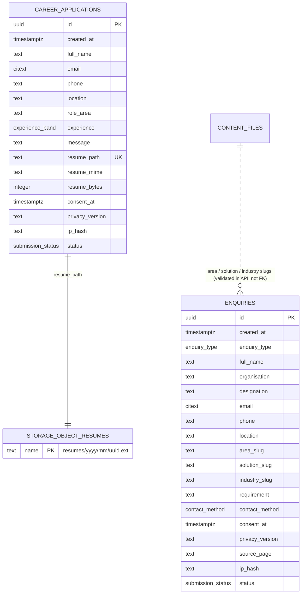

# DATABASE.md — SAID Technologies Website

Defines the complete data model for the SAID Technologies website.

- **Sources of truth:** PRD.md and ARCHITECTURE.md.
- **Scope:** The database stores **only what visitors submit**: business or education enquiries and career applications. All page content, including solutions, industries, education pages, blogs and case studies, lives in the repository as content files (ARCHITECTURE.md Section 5) and is **not** stored in the database.

---

## 1. Database Technology

| Item | Choice |
|---|---|
| Engine | PostgreSQL 15+ |
| Provider | Supabase, Mumbai region (`ap-south-1`) |
| File storage | Supabase Storage, private bucket `resumes` |
| Access | Server-side route handlers only, using the service-role key. No direct browser access. |
| Migrations | SQL files in `supabase/migrations/`, applied with the Supabase CLI |

**Why so small:** The site has no user accounts and no content in the database. Two tables cover every user journey that writes data. Lookup tables for solutions or industries would copy the content files and could drift out of sync, so the server checks slugs against the content files before inserting.

---

## 2. Tables

### 2.1 `enquiries`

This table stores Contact Us submissions for both business and education enquiries.

| Column | Type | Null | Default | Notes |
|---|---|---|---|---|
| `id` | `uuid` | no | `gen_random_uuid()` | Primary key |
| `created_at` | `timestamptz` | no | `now()` | |
| `enquiry_type` | `enquiry_type` (enum) | no | | `business` or `education` |
| `full_name` | `text` | no | | 2–120 characters |
| `organisation` | `text` | no | | 2–160 characters (company or institution) |
| `designation` | `text` | yes | | Up to 120 characters |
| `email` | `citext` | no | | Up to 254 characters, basic format check |
| `phone` | `text` | yes | | Up to 20 characters, digits, `+`, spaces and hyphens only |
| `location` | `text` | no | | City or project location, 2–120 characters |
| `area_slug` | `text` | no | | Solution area, for example `cybersecurity` or `school-education`. Validated against content by the API. |
| `solution_slug` | `text` | yes | | Specific service, for example `cloud-security` |
| `industry_slug` | `text` | yes | | One of the 9 industry slugs, validated against content by the API |
| `requirement` | `text` | no | | 10–4000 characters |
| `contact_method` | `contact_method` (enum) | no | | `email`, `phone` or `either` |
| `consent_at` | `timestamptz` | no | | Time consent was given. A row cannot exist without consent. |
| `privacy_version` | `text` | no | | Privacy Policy version the person agreed to, for example `2026-10` |
| `source_page` | `text` | yes | | Path the form was opened from, for example `/what-we-do/cybersecurity/cloud-security`. Up to 300 characters. |
| `ip_hash` | `text` | no | | SHA-256 of IP plus a server salt. Used only for rate limiting. |
| `status` | `submission_status` (enum) | no | `'new'` | `new`, `in_progress`, `closed` or `spam`. Updated by staff. |

### 2.2 `career_applications`

This table stores Careers "Share Your Profile" submissions.

| Column | Type | Null | Default | Notes |
|---|---|---|---|---|
| `id` | `uuid` | no | `gen_random_uuid()` | Primary key |
| `created_at` | `timestamptz` | no | `now()` | |
| `full_name` | `text` | no | | 2–120 characters |
| `email` | `citext` | no | | Up to 254 characters, format check |
| `phone` | `text` | no | | Up to 20 characters, same pattern as enquiries |
| `location` | `text` | no | | 2–120 characters |
| `role_area` | `text` | no | | Area of interest from the careers content, validated by the API |
| `experience` | `experience_band` (enum) | no | | `fresher`, `lt_1`, `1_3`, `3_5`, `5_10` or `10_plus`. These map to the six options on the live form, from "Student / fresher" to "More than 10 years". |
| `message` | `text` | yes | | Up to 2000 characters |
| `resume_path` | `text` | no | | Storage object key, for example `resumes/2026/10/<uuid>.pdf`. Unique. |
| `resume_mime` | `text` | no | | `application/pdf`, `application/msword` or the DOCX MIME type |
| `resume_bytes` | `integer` | no | | Greater than 0 and at most 5,242,880 bytes |
| `consent_at` | `timestamptz` | no | | |
| `privacy_version` | `text` | no | | |
| `ip_hash` | `text` | no | | |
| `status` | `submission_status` (enum) | no | `'new'` | |

### 2.3 Enum types

| Type | Values |
|---|---|
| `enquiry_type` | `business`, `education` |
| `contact_method` | `email`, `phone`, `either` |
| `submission_status` | `new`, `in_progress`, `closed`, `spam` |
| `experience_band` | `fresher`, `lt_1`, `1_3`, `3_5`, `5_10`, `10_plus` |

`enquiry_type` and `contact_method` match the radio values already used in `contact/index.html`. The careers experience options currently have no `value` attributes, so add these codes as values when the form is rebuilt. `role_area` stores one of the seven role labels from `careers/index.html`, for example "Enterprise IT and infrastructure".

### 2.4 Extensions

- `pgcrypto` for `gen_random_uuid()`
- `citext` for case-insensitive email

---

## 3. Keys and Relationships

| Table | Primary key | Foreign keys |
|---|---|---|
| `enquiries` | `id` | None |
| `career_applications` | `id` | None in SQL. `resume_path` points to an object in the `storage.objects` bucket `resumes`. |

The two tables are **independent**. There is no `users` table, because visitors are anonymous and every submission stands alone. If the same person submits twice, that produces two rows, which is the intended behaviour for a lead log.

### ER diagram

---

## 4. Constraints and Validation

Validation happens in two places with the same rules: the Zod schema in the API (ARCHITECTURE.md Section 6) and the database constraints listed here. The database is the last line of defence.

| Constraint | Rule |
|---|---|
| Lengths | `CHECK (char_length(col) BETWEEN min AND max)` for every text column, using the limits in Section 2 |
| Trimmed text | `CHECK (col = btrim(col))` on names, organisation and location. The API trims before insert. |
| Email | `CHECK (email ~* '^[^@\s]+@[^@\s]+\.[^@\s]+$')` |
| Phone | `CHECK (phone ~ '^\+?[0-9 \-]{7,20}$')` |
| Slugs | `CHECK (area_slug ~ '^[a-z0-9]+(-[a-z0-9]+)*$')`, and the same for the solution and industry slugs |
| Solution needs an area | Already enforced by `area_slug NOT NULL`. The API also checks that the solution belongs to the chosen area. |
| Consent | `consent_at NOT NULL`. A submission without consent cannot be stored. |
| Résumé | `resume_bytes BETWEEN 1 AND 5242880`, `resume_mime IN (...)` with the three allowed types, `resume_path UNIQUE` |
| Status | Enum type, so only the defined values are allowed |

Slugs are **not** foreign keys because solutions and industries live in content files, not in tables. The API rejects unknown slugs, and the slug pattern rule above stops arbitrary text from being stored.

---

## 5. Indexes

Indexes are based on the queries the system actually runs.

| Query | Where it runs | Index |
|---|---|---|
| Count submissions by `ip_hash` in the last 10 minutes (rate limit) | Every form POST | `enquiries (ip_hash, created_at DESC)` and `career_applications (ip_hash, created_at DESC)` |
| Newest submissions first, filtered by status (staff triage in the dashboard) | Staff, daily | `enquiries (status, created_at DESC)` and `career_applications (status, created_at DESC)` |
| Find all submissions from one email (follow-up, and data-subject requests under DPDP) | Staff, occasionally | `enquiries (email)` and `career_applications (email)` |
| Delete rows older than the retention period | Scheduled job, monthly | Covered by the `created_at` part of the status index. Add `(created_at)` only if the delete query is slow. |

There are no other indexes. Both tables are expected to stay in the thousands of rows per year.

---

## 6. Ownership and Authorisation

| Role | `enquiries` | `career_applications` | `resumes` bucket |
|---|---|---|---|
| `anon` (public key) | No access | No access | No access |
| `authenticated` (any Supabase Auth user) | No access | No access | No access |
| `service_role` (route handlers) | INSERT, SELECT (for the rate-limit count only) | INSERT, SELECT (for the rate-limit count only) | Upload, delete (rollback only) |
| SAID staff (dashboard users) | SELECT, UPDATE of `status` only | SELECT, UPDATE of `status` only | Download through signed URLs that expire after 10 minutes |
| Developers | Run migrations; no routine reading of personal data | Same | No routine access |

- **Data owner:** SAID Technologies is the data fiduciary under the DPDP Act. The development team acts as processor only.
- Staff access is granted by name and reviewed every quarter. Remove leavers on their last day.

---

## 7. Row-Level Security

- **Enable RLS on both tables**, and enable **FORCE RLS** as well, so even the table owner is subject to the policies.
- **Do not create any policies for `anon` or `authenticated`.** With RLS on and no policy, those roles are denied everything. This is intentional, because the public site never reads or writes the database directly.
- `service_role` bypasses RLS by design and is used only on the server.
- **Storage:** The `resumes` bucket is **private** with no public access, and it has no storage policies for `anon` or `authenticated`.
- **Future admin page:** Add a `staff_members (user_id uuid PK references auth.users, created_at)` table. Then add SELECT policies and an UPDATE policy on `status`, applied `TO authenticated USING (auth.uid() IN (SELECT user_id FROM staff_members))`. **Not part of the MVP.**

---

## 8. Sensitive-Data Handling

| Data | Sensitivity | Handling |
|---|---|---|
| Name, email, phone, organisation, designation, location | Personal data | Encrypted at rest by the provider, sent only over TLS, never written to logs and not sent to analytics |
| Requirement or message text | May contain business-confidential information | Same as personal data |
| Résumé files | **High.** They contain contact details, work history and sometimes date of birth or a photo. | Private bucket with random names and signed short-lived URLs. Never attached to email and never made public. |
| IP address | Personal data | **Never stored in raw form.** Only a salted SHA-256 hash is kept, and only for rate limiting. The salt lives in a server environment variable. |
| Consent | Legal record | Timestamp and Privacy Policy version kept with every row |

### Retention

The client must confirm these periods before launch.

| Data | Kept for | Then |
|---|---|---|
| `enquiries` | 24 months from `created_at` | Delete the row |
| `career_applications` and résumé files | 12 months from `created_at` | Delete the row **and** the storage object |
| `status = 'spam'` rows | 30 days | Delete |

- A scheduled job deletes expired rows monthly (Supabase `pg_cron`, or a Vercel cron that calls a protected server task). Résumé files are deleted before their rows.
- **Data-subject requests** (access or erasure): Staff look up the person by email using the email index and export or delete their rows and files. Record that the request was completed outside the database, by email.

---

## 9. Migration and Seed Strategy

### Migrations

- Each schema change is one numbered SQL file in `supabase/migrations/` and lives in the repository.
- **Initial set:**
  1. `0001_extensions.sql`: `pgcrypto`, `citext`
  2. `0002_types.sql`: the four enum types
  3. `0003_enquiries.sql`: table, constraints, indexes, RLS on, FORCE RLS
  4. `0004_career_applications.sql`: table, constraints, indexes, RLS on, FORCE RLS
  5. `0005_storage.sql`: private `resumes` bucket and its settings
  6. `0006_retention.sql`: retention function and schedule (after the client confirms the periods)
- Apply each migration to **local**, then **staging**, then **production**, always in that order and as a reviewed manual step.
- Make **additive changes only** once the site is live. To rename or remove a column, add the new column, deploy code that uses it, then drop the old column in a later migration.
- Adding an enum value uses `ALTER TYPE ... ADD VALUE`. Removing one needs a new type and a data migration, so avoid it.

### Seed data

- **Local and staging only:** `supabase/seed.sql` inserts about 10 clearly fake enquiries and 3 fake applications using `@example.com` emails, plus small placeholder PDF files. These let the team test the dashboard and the retention job.
- **Production:** no seed data. Content such as solutions, industries, blogs and case studies is not seeded because it is not in the database.

---

## 10. Backup and Recovery

| Item | Approach |
|---|---|
| Database backups | Supabase daily automated backups. Enable **Point-in-Time Recovery** on the production plan, because enquiries are revenue leads. |
| Storage (résumés) | Not covered by database backups. Back them up weekly with a script that copies the bucket to a separate private location with the same retention rules, or accept the risk in writing with the client. |
| Recovery targets | RPO 24 hours, or a few minutes with PITR. RTO 4 hours. |
| Restore test | Restore the production backup into a scratch project **every quarter**, check row counts, then delete the scratch project. |
| Losing the email notification | Not data loss, because the row is saved first. Staff check the dashboard for `status = 'new'` rows daily. |
| Total outage | The website stays up because pages are static. The forms show the email fallback from DESIGN.md Section 8, so no lead is lost. |
| Retention and backups | Backups older than the retention period must expire too. Keep backup retention at 30 days or less so deleted personal data does not stay in backups indefinitely. |
